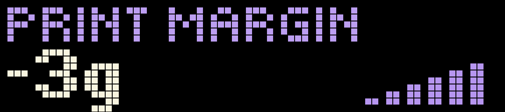
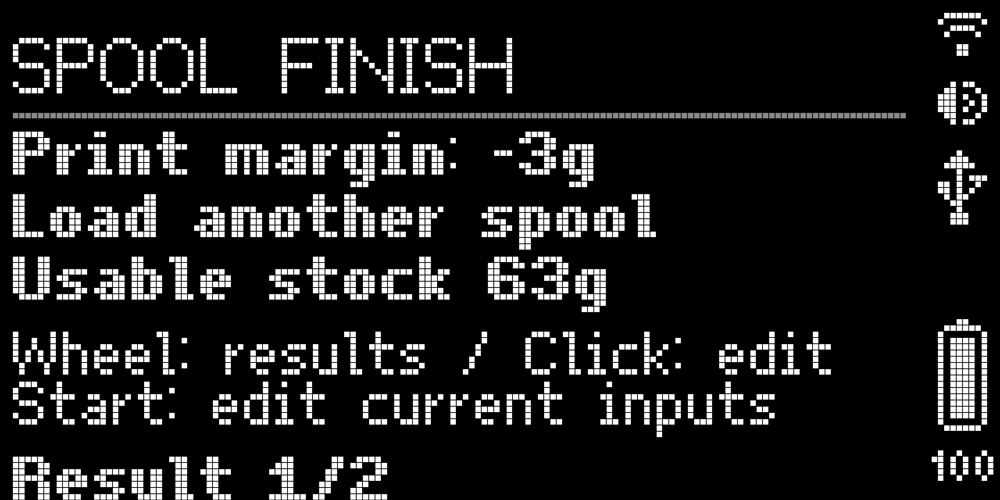

# Spool Finish

Check whether a weighed spool can finish a print after allowing for purge and safety margin.

A slicer can tell you how much a part uses. Your scale weighs the plastic and the spool together. Spool Finish does the subtraction at the printer and keeps the four numbers for the next job.

## Screen transitions

Change the spool selection and read the material left after the print.



<details>

<summary>Watch the rear display</summary>



</details>

## Decide whether to start the print

1. Weigh the loaded spool. In the recorded example it weighs **223 g**. An empty spool of the same type weighs **160 g**, leaving **63 g** of filament.
2. Read **PRINT MARGIN**. This job needs 58 g for the part and 8 g for purge. The display shows **−3 g**.
3. Turn the wheel forward to **REQUIRED**. The **66 g** here includes both the printed part and its purge. Turn back to see the shortfall again.


## Use the same calculation with a fresh spool

1. Click the wheel on a result to enter the editor. **GROSS SPOOL** is the first field.
2. Turn one notch for each gram. The clip moves from **223 g** to **224 g** and back, so you can see which number the wheel is changing.
3. Click through **Empty tare**, **Print use** and **Purge**, setting each in grams. Press **Start** to return to the result. A wheel hold in the editor restores the selected field’s starting value.


## Which numbers to use

Use the tare for this spool design. Two spools carrying the same type of filament can have different empty weights. Enter the slicer’s part and purge estimates separately so you can account for a multicolour print or a new purge setting. A positive margin is the weight left after both allowances. The calculation uses the weights you enter and requires no connection to the printer.

## Run in the emulator

Open BUSY Bar Emulator. From this repository, run:

```sh
~/.busy-emulator/bin/busy-emulator dev --once
```

Press **Back** to exit.

The GIFs are excerpts from the emulator recording. Each LED occupies a 16 × 16 cell with a black border. The last frame pauses for reading.

[Full recording](media/controls.mp4) · [Rear display](screenshots/back-1.png) · [Firmware test](EMULATOR-QA.md) · [MIT license](LICENSE)
